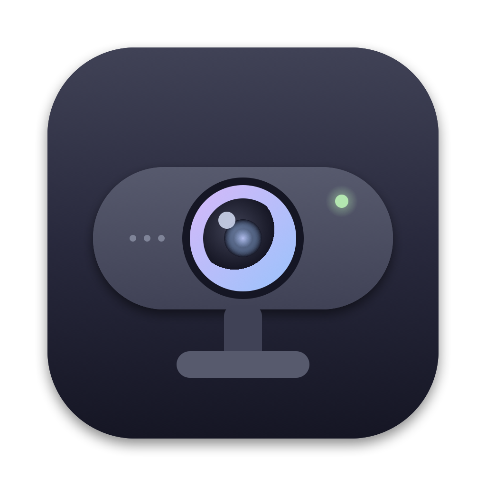

# Facecam

A small native macOS menu bar app and CLI for Elgato Facecam webcams. It talks to the camera directly over
UVC, so no vendor software has to be installed or running.



|  | Elgato Camera Hub 2.3.0 | Facecam |
| --- | --- | --- |
| Installed size | 876 MB | **1.9 MB** (CLI: 3.7 MB) |
| Download | | **971 KB** DMG |
| Built on | Qt 6 + Chromium (QtWebEngine), bundled USB and ISP SDKs | SwiftUI + IOKit |

Same camera controls, about 460× smaller.

- Image, exposure, white balance and framing controls, including the Elgato-specific ones (HDR, vibrancy, tint,
  noise reduction, metering)
- Live preview while the panel is open
- Profiles, with optional auto-apply when the camera is plugged in
- **Save to camera**: stores the current settings in the camera so they apply in every app, with nothing running

Tested with the Facecam MK.2 on macOS 27. Requires macOS 14 or newer. Other models that expose the same extension units should work;
controls the camera does not advertise are hidden.

## Install

Download `Facecam-<version>.dmg` from [Releases](../../releases) and drag Facecam to Applications.

The app is not notarized. On first launch macOS will block it; either right-click the app and choose **Open**, or run:

```sh
xattr -dr com.apple.quarantine /Applications/Facecam.app
```

The CLI is in `facecam-<version>-macos.tar.gz`; put `facecam` anywhere on your `PATH`.

## CLI

```sh
facecam list                       # connected cameras
facecam info                       # units, firmware version
facecam get                        # all controls with ranges
facecam set hdr=on noise-reduction=low metering=spot zoom=150
facecam reset                      # camera defaults
facecam save                       # store current settings in the camera
facecam profile save calls         # snapshot to ~/Library/Application Support/Facecam/profiles
facecam profile apply calls
```

Set `FC_DEBUG=1` to log raw USB control transfers.

## Build

Requires Xcode 16 or newer.

```sh
swift test
./scripts/bundle.sh         # build/FacecamBar.app and build/facecam (universal)
./scripts/dmg.sh            # dist/Facecam-<version>.dmg and the CLI tarball
./scripts/make-icon.sh      # regenerate Resources/AppIcon.icns
```

Pushing a `v*` tag runs CI and publishes a GitHub release with the DMG and CLI.

## Protocol

Standard UVC controls go to the camera terminal and processing unit. Elgato-specific controls live in two
vendor extension units, found by GUID:

| Unit | GUID | Selectors |
| --- | --- | --- |
| Image | `23e49ed0-1178-4f31-ae52-d2fb8a8d3001` | `0x02` metering (0 center-weighted, 1 spot, 2 average), `0x0e` vibrancy, `0x12` tint, `0x15` HDR, `0x16` noise reduction (0 off, 1 low, 2 medium, 3 high), `0x18` digital pan/tilt |
| Device | `2c49d16a-32b8-4485-3ea8-643a15236002` | `0x01` features (firmware version), `0x07` save settings (write `1`) |

After a write, extension-unit controls read back `0xff` for about 600 ms while the camera applies the change.

Not affiliated with Elgato or Corsair.
